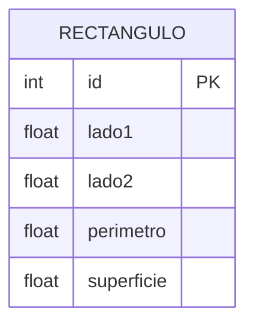

# Diagrama Entidad-Relación - Ejercicio 1

## Fundamentación
El modelo de datos cuenta con una única tabla `Rectangulo` que almacena sus dimensiones fundamentales (lado1 y lado2), además de su perímetro y superficie precalculados en el backend, lo cual evita recálculos futuros y protege la integridad de los datos (al no confiar en lo que el cliente pueda enviar). 

La API se diseñó siguiendo el estándar REST. Se exponen endpoints para crear (POST), leer (GET), actualizar (PUT) y borrar (DELETE) rectángulos. Validamos los tipos de datos y prevenimos la inyección de campos no permitidos (como perimetro o superficie desde el cliente) mediante `express-validator`.
