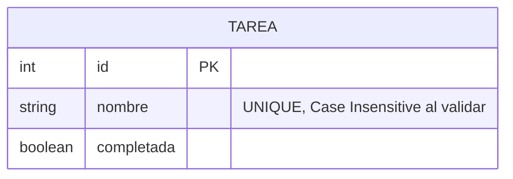

# Diagrama Entidad-Relación - Ejercicio 2

## Fundamentación
La entidad `Tarea` modela los requisitos básicos solicitados. 
El campo `nombre` debe ser único, por lo que a nivel de API se implementa una normalización del texto (recorte de espacios y paso a minúsculas) antes de crear o actualizar, previniendo duplicados semánticos como "   Mi Tarea " y "mi tarea".

La API usa los métodos `GET`, `POST`, `PUT` y `DELETE`. Para el filtrado de tareas pendientes o completadas, se utilizó el concepto de Query Params (`?estado=completada`) en el método GET `/api/tareas`, ya que los filtros son parámetros de consulta opcionales y no recursos en sí mismos. Las validaciones con `express-validator` garantizan que los estados solo puedan ser los permitidos, y que las solicitudes contengan los tipos de datos correctos.
