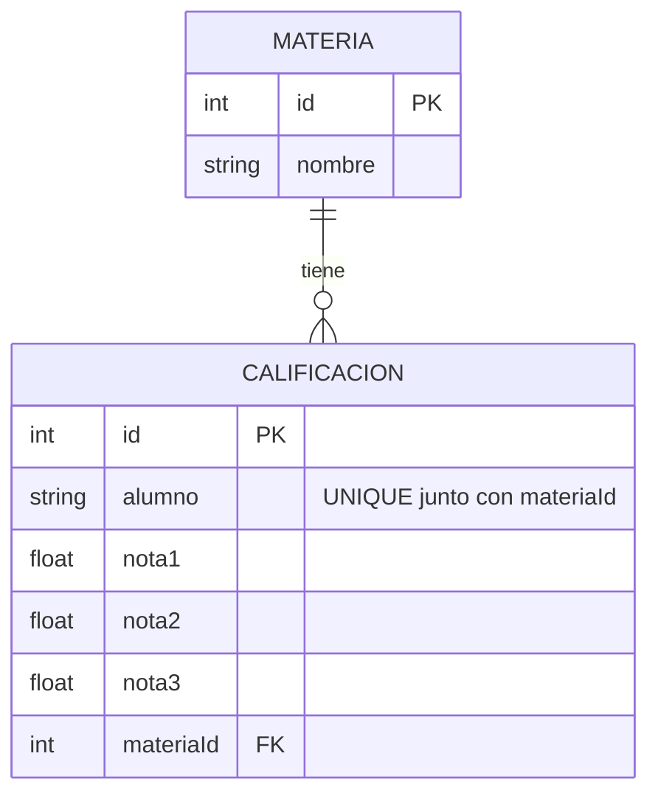

# Diagrama Entidad-Relación - Ejercicio 3

## Fundamentación
El modelo se divide en dos tablas: `Materias` y `Calificaciones`. Se estableció una relación de 1 a N entre Materias y Calificaciones, usando `materiaId` como clave foránea en la tabla Calificaciones, respetando la 3° Forma Normal.

La API asegura la integridad obligando a que se informen siempre exactamente tres notas dentro del rango 1-10 (definido como regla de negocio).
Además, a nivel de controlador se valida que no pueda existir la misma combinación `alumno` y `materiaId`, aplicando normalización (case insensitive y sin espacios extra) para identificar repeticiones semánticas (por ejemplo, "Veronica Velez" y "veronica velez").
Todas las rutas están protegidas con `express-validator` para garantizar consistencia antes de interactuar con la base de datos (SQLite usada como base, escalable a MySQL cambiando el dialecto).
